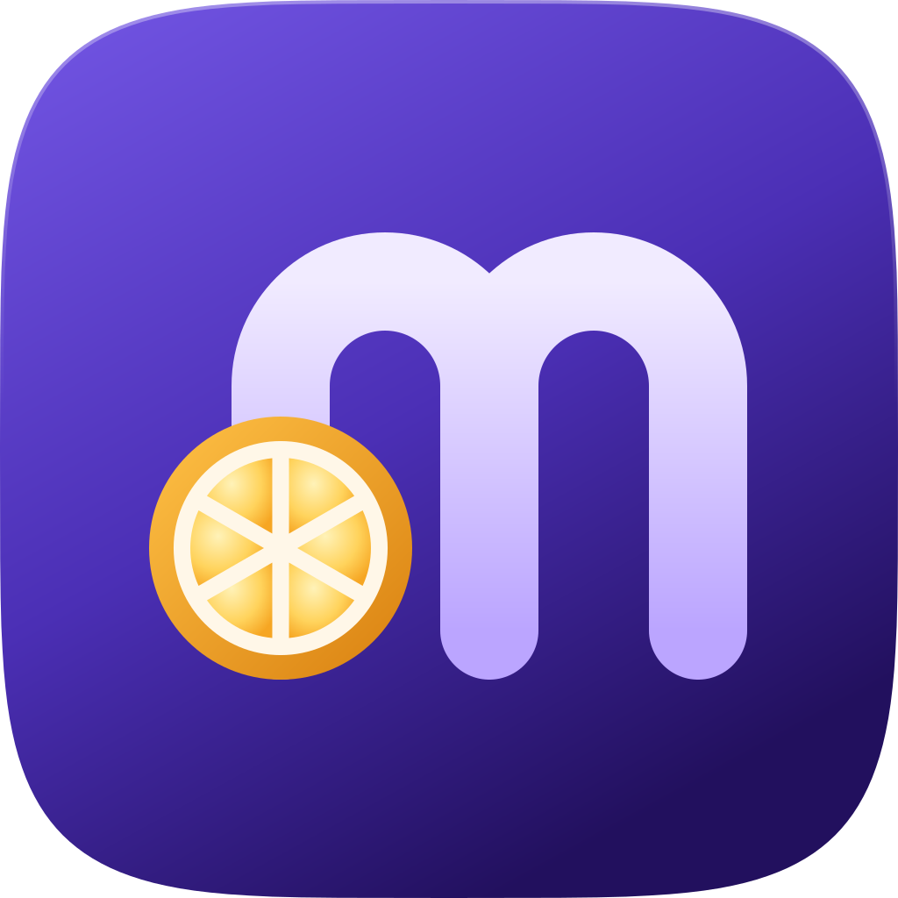
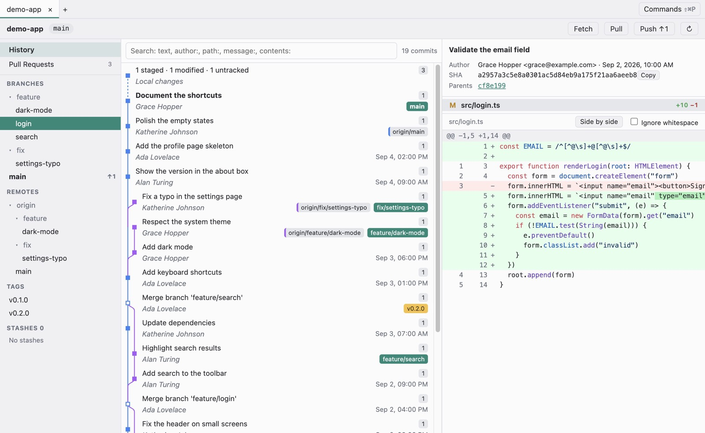
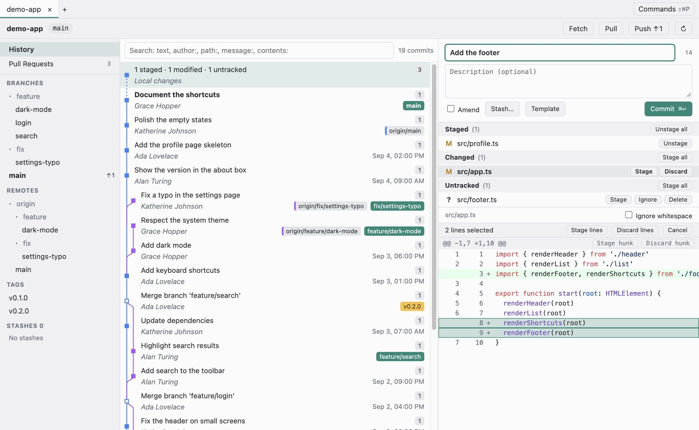
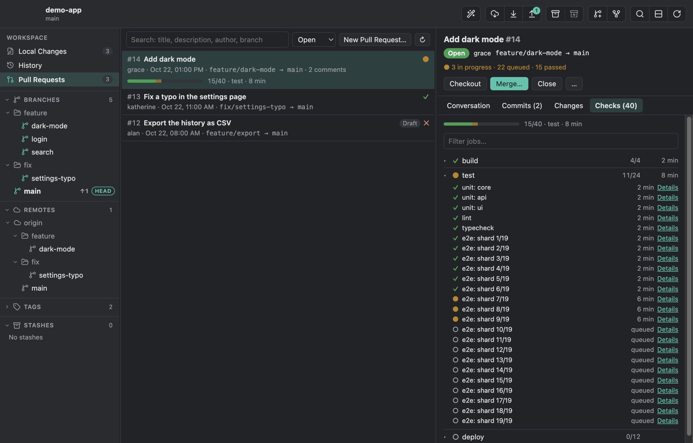
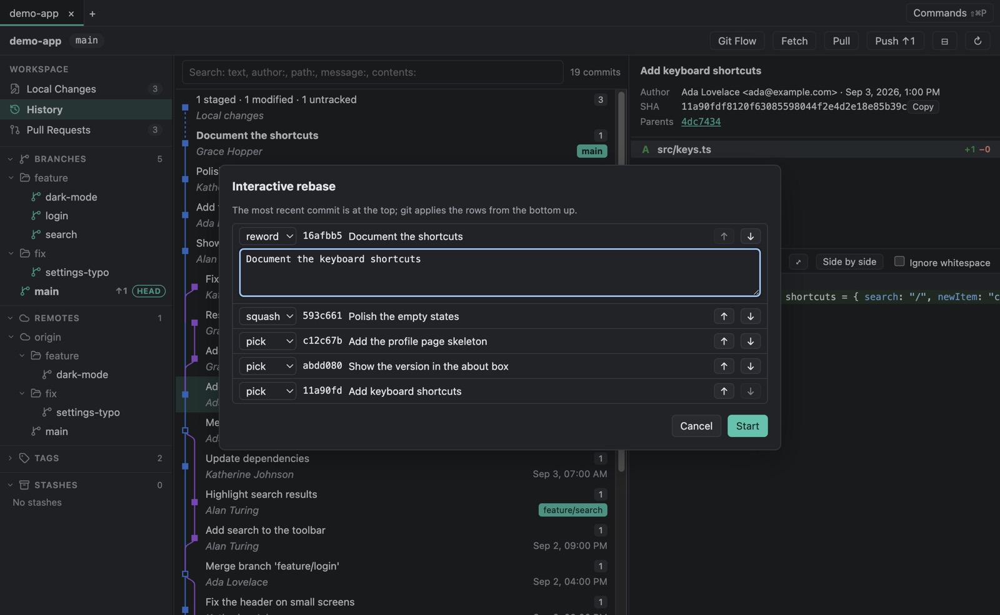
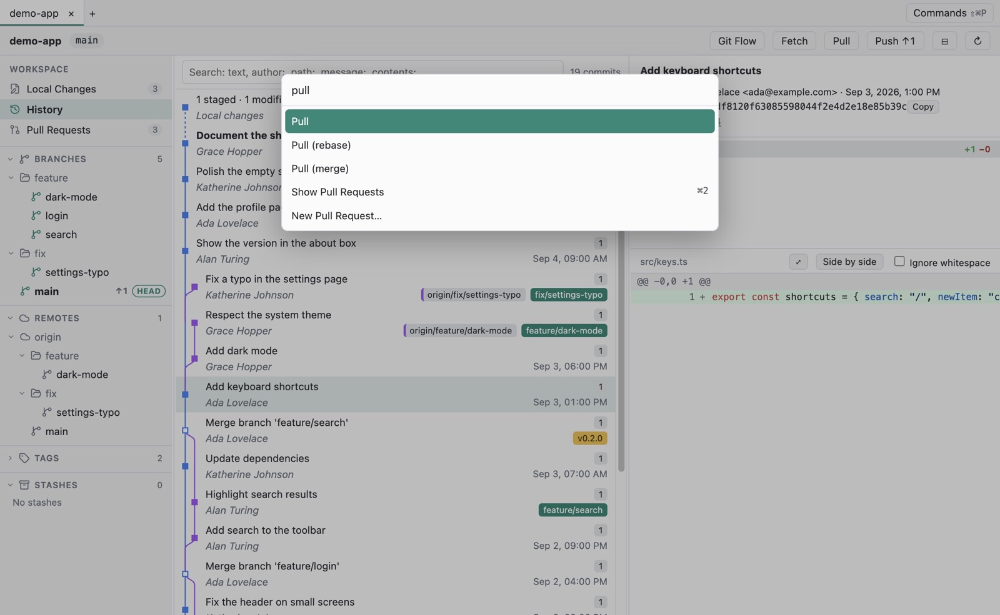

<div align="center">



# Merlino

**Your git, at a glance.**

A fast, keyboard-first Git client for macOS, Windows and Linux.<br>
History, local changes, branches and pull requests, on top of the git you already use.

<a href="https://github.com/cavallefano/merlino/releases/latest"></a>

[](LICENSE)
[](https://www.electronjs.org)
[](https://vuejs.org)
[](https://www.typescriptlang.org)
[](#download)

</div>

<br>

<picture>
  <source media="(prefers-color-scheme: dark)" srcset="docs/assets/screenshots/history-dark.jpg">
  
</picture>

## Why Merlino

Git clients tend to trade speed for depth. Merlino keeps both for the work you do every day: reading history, shaping commits, moving branches around and getting pull requests merged.

- **Your git.** Every operation runs the `git` you already have, so hooks, LFS, signing, credential helpers and your config behave exactly as they do in the terminal.
- **Fast on big repositories.** The first screen of a 100,000-commit history appears in under 2 seconds, and only the visible rows are drawn.
- **Keyboard first.** `⌘⇧P` reaches every action with fuzzy search. The same actions live in the menu bar and in the context menus, with their shortcuts.
- **Direct manipulation.** Drop a branch on the current one to merge it, a commit to cherry-pick it, files between sections to stage them. Hold `⌥` for the alternative.
- **Pull requests inside.** GitHub and GitLab: read the conversation and the changes, follow running pipelines, merge, check out and create, without leaving the app.

## A quick tour

<table>
  <tr>
    <td width="50%"></td>
    <td width="50%"></td>
  </tr>
  <tr>
    <td><b>Local changes.</b> Stage, unstage or discard a file, a hunk or single lines, then commit with <code>⌘↩</code>. Templates fill in the message from the branch and its ticket.</td>
    <td><b>Pull requests.</b> Running pipelines show their progress right in the list. The Checks tab groups hundreds of jobs by stage or workflow.</td>
  </tr>
  <tr>
    <td></td>
    <td></td>
  </tr>
  <tr>
    <td><b>Interactive rebase.</b> Reorder, reword, squash, fix up, edit or drop commits in one dialog, with no editor to configure.</td>
    <td><b>Command palette.</b> <code>⌘⇧P</code> searches every action and shows its shortcut.</td>
  </tr>
</table>

## What you get

| Area | Included today |
| --- | --- |
| History | Commit graph of every branch, remote branch and tag, with colored lanes. Search by text, `author:`, `path:`, `message:` or `contents:`. Commit details with clickable parents. Diffs unified or side by side, with syntax highlighting, word-level changes and an option to ignore whitespace |
| Local changes | Stage, unstage and discard by file, hunk or line. Add files to `.gitignore`. Commit composer with length guides, amend and templates (`{branch}`, `{ticket}`, and Git's own `commit.template`). Stashes, also of single files. A banner to continue, skip or abort a merge, rebase, cherry-pick or revert with conflicts |
| Branches and remotes | Branches in folders with ahead/behind counts. Create, check out, rename, delete, set the upstream. Merge, rebase, cherry-pick, revert, reset and interactive rebase. Tags. Clone, fetch (also in the background), pull, push with `--force-with-lease`, remotes. Git flow: start and finish features, bugfixes, releases and hotfixes (locally, or through a pull request), and support branches, compatible with the `git flow` command line |
| Drag and drop | Merge, rebase, cherry-pick, revert, push, fast-forward, set the upstream, stage, stash and apply by dragging, with a label that says what will happen. Files from any commit can be dragged to other apps |
| Pull requests | GitHub (also Enterprise) and GitLab (also self-hosted) with a personal access token. List with search, filters and CI status. Conversation in Markdown, commits and changes read with your git. Pipelines with progress and jobs by stage. Comment, check out (forks too), merge with the methods the repository allows, close, reopen, create |
| Everyday use | Tabs restored at launch. Open a repository from the dialog, by dropping its folder or from the command line. Command palette, menu bar and context menus with the same actions. An output panel with every git command. Open in your terminal or editor |
| Settings | Language (English or Italian), theme, automatic fetch, commit guides and templates, diff view and algorithm, editor and terminal, accounts, and your global Git identity, signing and pull strategy |
| Quality | Clear messages for the usual git failures. A confirmation before every destructive operation. A sandboxed interface that can only call validated operations. Tested against real git: unit, integration and end-to-end |

<details>
<summary><b>All drag and drop gestures</b></summary>

Drop to run the action; hold <kbd>⌥</kbd> (<kbd>Alt</kbd> on Windows and Linux) for the alternative.

| Drag | Onto | Action | With <kbd>⌥</kbd> |
| --- | --- | --- | --- |
| A branch (local or remote) | The current branch | Merge it into the current branch | Rebase the current branch onto it |
| A remote branch | Another local branch | Fast-forward it, without checking it out | Set it as upstream |
| A local branch | A remote, or one of its branches | Push it (and set the upstream) | Set the upstream only |
| A local branch | "Pull Requests" | New pull request from it | |
| A commit | The current branch or the local changes | Cherry-pick | Revert |
| A commit, branch or tag | The "Branches" header | New branch from there | |
| A commit | The "Tags" header | New tag on it | |
| Changed files | "Staged" / "Changed" | Stage / unstage | |
| Changed files | The "Stashes" header | Stash only those files | |
| A stash | The local changes | Apply | Pop |
| A file from a commit or stash | The local changes | Apply just that file's changes | |
| Any file | Outside Merlino (Finder, editor, chat…) | The file (from a commit: its content at that commit) | |

</details>

<details>
<summary><b>Keyboard shortcuts</b></summary>

| Action | macOS | Windows / Linux |
| --- | --- | --- |
| Command palette | <kbd>⌘</kbd><kbd>⇧</kbd><kbd>P</kbd> | <kbd>Ctrl</kbd>+<kbd>Shift</kbd>+<kbd>P</kbd> |
| Open repository | <kbd>⌘</kbd><kbd>O</kbd> | <kbd>Ctrl</kbd>+<kbd>O</kbd> |
| Refresh | <kbd>⌘</kbd><kbd>R</kbd> | <kbd>Ctrl</kbd>+<kbd>R</kbd> |
| Search history or pull requests | <kbd>⌘</kbd><kbd>F</kbd> | <kbd>Ctrl</kbd>+<kbd>F</kbd> |
| History / Pull requests | <kbd>⌘</kbd><kbd>1</kbd> / <kbd>⌘</kbd><kbd>2</kbd> | <kbd>Ctrl</kbd>+<kbd>1</kbd> / <kbd>Ctrl</kbd>+<kbd>2</kbd> |
| Commit, or send a comment | <kbd>⌘</kbd><kbd>↩</kbd> | <kbd>Ctrl</kbd>+<kbd>Enter</kbd> |
| Settings | <kbd>⌘</kbd><kbd>,</kbd> | <kbd>Ctrl</kbd>+<kbd>,</kbd> |
| Output panel | <kbd>⌘</kbd><kbd>⇧</kbd><kbd>O</kbd> | <kbd>Ctrl</kbd>+<kbd>Shift</kbd>+<kbd>O</kbd> |
| Close tab | <kbd>⌘</kbd><kbd>W</kbd> | <kbd>Ctrl</kbd>+<kbd>W</kbd> |
| Next / previous tab | <kbd>⌃</kbd><kbd>Tab</kbd> / <kbd>⌃</kbd><kbd>⇧</kbd><kbd>Tab</kbd> | <kbd>Ctrl</kbd>+<kbd>Tab</kbd> / <kbd>Ctrl</kbd>+<kbd>Shift</kbd>+<kbd>Tab</kbd> |

</details>

## Download

Get the package for your system from the [Releases](https://github.com/cavallefano/merlino/releases) page. Merlino needs git 2.35 or newer.

| System | Package |
| --- | --- |
| macOS, Apple Silicon | `Merlino-<version>-mac-arm64.dmg` |
| macOS, Intel | `Merlino-<version>-mac-x64.dmg` |
| Windows | `Merlino-<version>-windows-setup.exe` |
| Linux | `Merlino-<version>-linux-x86_64.AppImage`, or `Merlino-<version>-linux-amd64.deb` for Debian and Ubuntu |

The packages are not signed with a developer certificate, so the first launch needs a confirmation:

- **macOS:** open the app once, then go to System Settings → Privacy & Security and click "Open Anyway".
- **Windows:** in the SmartScreen dialog, click "More info", then "Run anyway".
- **Linux:** `chmod +x Merlino-*.AppImage` and run it, or install the package with `sudo apt install ./Merlino-*-linux-amd64.deb`.

## How it works

- **Your git, not a reimplementation.** Every operation runs the system `git` as a separate process. There is no libgit2, so hooks, LFS, signing and credential helpers behave as they do in your terminal. Write operations on a repository are queued, so they never overlap.
- **Locked-down interface.** The interface runs sandboxed with context isolation. It can only call named, typed operations that the main process validates one by one: branch names, SHAs and paths are checked, and the interface can never pass arbitrary arguments to git.
- **No telemetry.** Besides what git itself does (clone, fetch, pull, push), Merlino only contacts the GitHub and GitLab servers of the accounts you connect, with the token you gave it. Tokens are encrypted with the system keychain (on Linux without a keychain, Electron can only use weak encryption) and never reach the interface or the logs.

## Tech stack

| Layer | Choices |
| --- | --- |
| Desktop | Electron 45 with a sandboxed renderer and context isolation, electron-vite, electron-builder |
| Interface | Vue 3, Pinia, TypeScript 6, highlight.js, marked and DOMPurify |
| Git | The system `git` 2.35 or newer, run as a process with queued writes; `@parcel/watcher` for changes on disk |
| Services | GitHub and GitLab REST APIs through Electron's network stack, tokens encrypted with `safeStorage` |
| Quality | TypeScript strict, ESLint, vue-tsc, Vitest on real git repositories, Playwright end-to-end tests with a hidden window |
| Delivery | GitHub Actions: packages for macOS, Windows and Linux on every version tag |

## Build from source

You need git 2.35 or newer and Node.js 24.

```bash
git clone https://github.com/cavallefano/merlino.git
cd merlino
npm install
npm run dev     # the app with hot reload
npm run dist    # packages for this system, in dist/
```

<details>
<summary><b>All commands</b></summary>

| Command | What it does |
| --- | --- |
| `npm run dev` | Run the app with hot reload |
| `npm run build` | Build main process, preload and interface into `out/` |
| `npm run dist` | Package for the current system into `dist/` (`.dmg`, NSIS installer, or AppImage and `.deb`) |
| `npm run lint` | ESLint |
| `npm run typecheck` | TypeScript and vue-tsc |
| `npm test` | Unit and integration tests, on real git with temporary repositories |
| `npm run test:e2e` | Build, then end-to-end tests on the Electron app with a hidden window |
| `MERLINO_PERF=1 npx vitest run test/integration/history-perf.test.ts` | The 100,000-commit performance test |
| `npx electron scripts/make-icons.mjs` | Regenerate the app icons from `build/icon.svg` (macOS) |
| `MERLINO_SCREENSHOTS=1 npx playwright test test/e2e/readme-screenshots.spec.ts` | Regenerate the screenshots of this page, after `npx electron-vite build` (macOS) |

End-to-end tests never show a window or steal focus, and no test touches your own `~/.gitconfig`: tests that need a global config point `GIT_CONFIG_GLOBAL` at a temporary file.

</details>

<details>
<summary><b>Repository layout</b></summary>

```
src/main/       Electron main process: git runner and parsers, GitHub and GitLab clients, IPC, settings, menus
src/preload/    the typed bridge exposed to the interface (window.api)
src/renderer/   Vue 3 interface: components, Pinia stores, actions, drag and drop
src/shared/     types and IPC contract shared by main and interface; translations in src/shared/i18n/
build/          app icon (icon.svg is the source)
scripts/        icon generator and other maintenance scripts
test/           unit, integration (real git) and end-to-end (Playwright) tests
docs/           design specs and implementation plans (in Italian), screenshots
```

</details>

<details>
<summary><b>Releasing</b></summary>

From an up-to-date `main`:

```bash
npm version minor        # or patch / major: updates package.json, commits and tags vX.Y.Z
git push --follow-tags
```

The tag starts the **Release** workflow: lint, type checks and unit and integration tests, then a draft release "Merlino X.Y.Z" with generated notes, and the packages built on macOS, Windows and Linux. Review the draft on GitHub and publish it. The tag must match the version in `package.json`, otherwise the workflow stops.

For a test build without a release, run the workflow by hand (Actions → Release → Run workflow, or `gh workflow run release.yml`): the packages are attached to the run as artifacts.

</details>

## Roadmap

- [x] History: commit graph, search, commit details and diffs
- [x] Local changes: line staging, commit composer with templates, stashes, operations with conflicts
- [x] Branches, tags and remotes, with interactive rebase
- [x] Drag and drop for every common operation
- [x] Settings, in English and Italian
- [x] Pull and merge requests: list, conversation, changes, merge, check out, create
- [x] Pipelines with progress and jobs by stage
- [x] Packages for macOS, Windows and Linux on GitHub Releases
- [x] Git flow, with finish by local merge or pull request
- [ ] Reviews: approve, request changes, comments on diff lines
- [ ] Three-way merge tool
- [ ] Blame, file history and a tree view of the repository
- [ ] Submodules, worktrees and custom commands

## Contributing

Issues and pull requests are welcome.

- Please run `npm run lint`, `npm run typecheck`, `npm test` and `npm run test:e2e` before opening a pull request.
- Every new interface text goes in `src/shared/i18n/en.ts` and in `it.ts` (see [Translations](#translations)).
- Commit messages follow the `feat:` / `fix:` / `docs:` / `test:` style used in the history.

## Translations

Interface texts live in `src/shared/i18n/`: `en.ts` is the reference, every other language has the same keys.

To add a language:

1. Copy `it.ts` to a new file (for example `fr.ts`), name the export after the language and translate the texts. Keep the `{placeholders}` as they are; plurals use the `.one` / `.other` keys.
2. In `src/shared/i18n/index.ts`, add the language code to `Lang` and `LANGUAGES`, the dictionary to `dictionaries`, and its date locale to `dateLocale`.
3. Add its name, written in that language, as `language.<code>` in every dictionary.

`npm test` checks that every translation has the same placeholders as English and no empty text.

## License

Merlino is free software under the [MIT License](LICENSE). You can use, modify and redistribute it, also in commercial products, as long as you keep the copyright notice.
